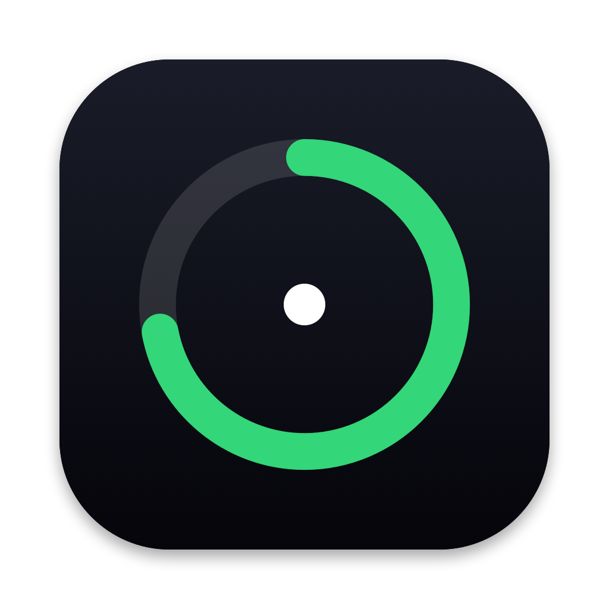
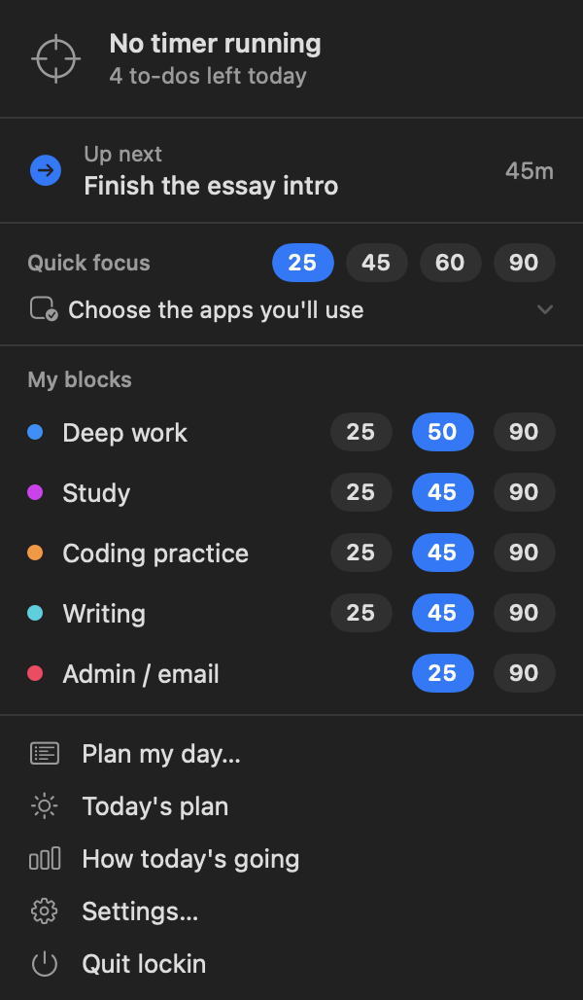
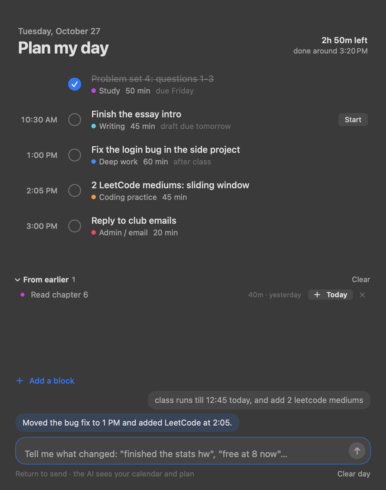
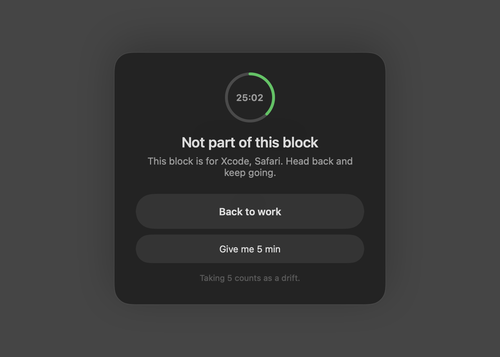

<p align="center"></p>

# lockin

A focus timer for macOS that lives in the notch, notices the moment you drift
off task, and plans your day around your calendar. It works fully offline;
there's an optional AI planner if you want one (your Claude subscription, your
own API key, or a local model).

It's built for the gap between "I should work on this" and actually doing it:
start a block, and the timer sits in the notch where you can't miss it. Wander
onto YouTube and a cover slides over the page. Leave for ten minutes and it
counts that as drifting too, unless you said you'd be working on paper.

<p align="center">
  
  &nbsp;
  
  &nbsp;
  
</p>

<br>

## What it does

- **Lives in the notch.** A small pill wraps the camera housing: a progress ring
  on the left, time remaining on the right. It's sized from the real notch
  geometry and follows whichever screen your mouse is on. Macs without a notch
  get the same pill under the menu bar.
- **Quick focus.** Pick a length and the apps you'll use. Anything else you
  open gets covered until the timer ends. No setup needed.
- **Knows when you drift.** Each focus block lists the apps, sites and project
  folders that count as on task. lockin checks the front app, the open browser
  tab, and even which folder your terminal's Claude Code session is in. After
  30 seconds off task it nudges you; after a few minutes away from the Mac it
  counts that too (or doesn't, for blocks marked "offline is fine").
- **Covers distractions.** During a block, YouTube/Reddit/etc. get a blurred
  cover with *Back to work*, *Close tab* or *Give me 5 min*. The tab stays
  open so you don't lose your place. Turn on **Only allow these apps and
  sites** for a block and *everything* outside its list gets covered.
- **Plans your day, by hand or with AI.** Add blocks yourself and lockin fills in
  the **soonest open time**, working around your calendar and what's already
  planned. Or type a messy brain dump ("stats hw, gym at 6, finish the essay
  intro") and the AI planner turns it into a timed schedule, then edits it as
  you go ("free at 8 now", "finished the stats hw").
- **Keeps the day moving.** A morning plan the first time you sit down, a
  gentle "up next" when no timer is running, and an evening recap of focused
  time, finished blocks and your biggest distractions. Unfinished to-dos roll
  into a "from earlier" list instead of nagging you.
- **Scriptable.** `lockin://start?block=Study&minutes=25`, `lockin://next`,
  `lockin://stop` and friends work from Shortcuts, Raycast or a terminal.

<br>

## Requirements

- macOS 14 (Sonoma) or later, Apple silicon or Intel
- Nothing else for the app itself. The helper script runs on the Python that
  ships with macOS.

<br>

## Install

**Download** (no Xcode needed):

```bash
curl -fsSL https://raw.githubusercontent.com/helzeiah/lockin/main/install.sh | bash
```

That puts `lockin.app` in `~/Applications` and opens it. A target icon appears
in the menu bar. You can also grab `lockin.zip` from the
[latest release](https://github.com/helzeiah/lockin/releases/latest), unzip it,
and drag the app into Applications. The first time, right-click it and choose
**Open** (the app isn't notarized, so macOS asks once).

**Build from source** (needs the Xcode Command Line Tools: `xcode-select --install`):

```bash
git clone https://github.com/helzeiah/lockin.git
cd lockin
./app/build.sh
```

<br>

## Permissions

macOS asks for these the first time they're needed:

| Permission | Why |
|---|---|
| **Automation** (your browser, Terminal/iTerm) | To read the current tab's URL and title, and the terminal's folder. Nothing is stored. |
| **Calendar** | To plan around today's events. Read-only. |

Both are optional. Without them, drift detection falls back to app names, and
planning ignores your calendar.

<br>

## The AI planner (optional)

Pick one in **Settings → AI planner**, or leave it on *None*:

| Option | What you need |
|---|---|
| **Claude Code** | The `claude` CLI, signed in with a Claude subscription. No key. |
| **Claude API key** | A key from [console.anthropic.com](https://console.anthropic.com). Default model: `claude-opus-5-5`. |
| **OpenAI API key** | A key from [platform.openai.com](https://platform.openai.com). |
| **Other** | Any OpenAI-compatible endpoint: [OpenRouter](https://openrouter.ai), Gemini, Groq, or a local model through [Ollama](https://ollama.com) / LM Studio (no key, nothing leaves your Mac). |

Keys are stored in your **macOS Keychain**, never in a file. **Save and test**
checks the connection. The planner only sees your to-dos, today's calendar
event titles, and what you type to it.

<br>

## Setting up your blocks

Open **Settings → Focus blocks**. Each block has:

- a default length
- **on-task websites** and **apps** (case-insensitive substring match, so
  `leetcode` covers every LeetCode page)
- **Claude Code project folders** that count as on task
- whether **time away from the Mac** counts as focus (for reading, paper or
  iPad work)
- whether the **terminal** counts as on task
- **Only allow these apps and sites**: cover anything outside the list

**General → Menu shows** switches the menu between quick focus, your saved
blocks, or both.

**Distractions** sets the sites that get covered, the apps and sites that count
as drifting, and the apps that are always fine (Spotify, Finder...).

<br>

## How it works

```
app/Sources/          SwiftUI menu-bar app (no Xcode project, built with swiftc)
  Engine.swift          the timer, drift detection loop, nudges, plan/recap cards
  Detect.swift          front app, browser tab (AppleScript), terminal folder, idle time
  Island.swift          the notch pill: reads notch geometry, follows the active screen
  Blocker.swift         the blurred cover over distracting tabs
  Planner.swift         the "Plan my day" window: timeline, manual add, AI chat
  Settings.swift        settings window
coach.py              helper: morning plan, recap, soonest-slot finder, AI planner
ai.py                 one function, ask_json(): Claude Code / Claude API / OpenAI / compatible
bin/calevents.swift   tiny EventKit reader that prints today's events as JSON
```

Every couple of seconds the engine looks at what's in front of you and
compares it to the active block's rules. Being off task starts a grace timer;
when it runs out you get a nudge in the notch, and repeated drift gets
re-nudged on an interval. The AI planner asks for JSON that matches a schema
(structured outputs on the Claude and OpenAI APIs, with a plain-JSON fallback
for servers that don't support schemas), so the reply always drops straight
into the plan.

Your data stays in `~/Library/Application Support/lockin`: `config.json`
(settings), `todos.json` (today's plan and backlog), `log.jsonl` (focus history
for the recap) and `state.json` (the running block, so a restart doesn't lose
it).

<br>

## Development

```bash
./app/build.sh             # build for this Mac, install to ~/Applications, restart it
./app/build.sh --release   # universal build + dist/lockin.zip
swift app/make-icon.swift  # redraw the app icon
```

Pushing a `v*` tag builds a universal release and attaches `lockin.zip` to a
GitHub release (`.github/workflows/release.yml`).

**Tip:** macOS ties permissions to the app's signature, and the default ad-hoc
signature changes on every build, so you'd re-approve Calendar/Automation each
time. Make a free local signing certificate once: *Keychain Access → Certificate
Assistant → Create a Certificate…*, name it `lockin Local Signing`, type *Code
Signing*. `build.sh` uses it automatically.

<br>

## Uninstall

Quit lockin from its menu, then:

```bash
rm -rf ~/Applications/lockin.app ~/Library/Application\ Support/lockin
```

<br>

## License

[MIT](LICENSE)
