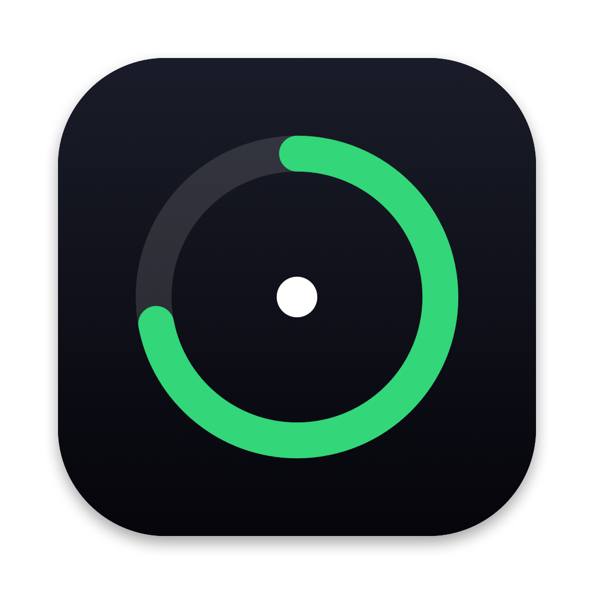
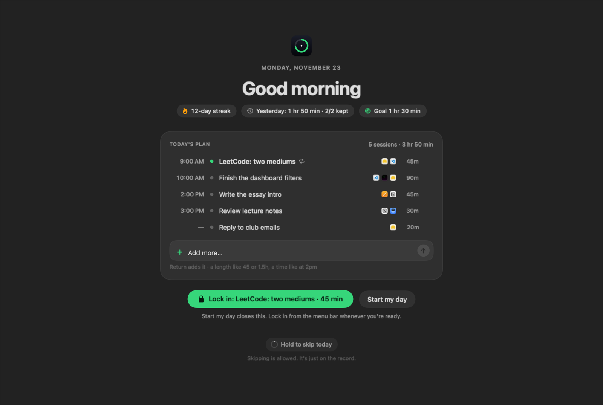
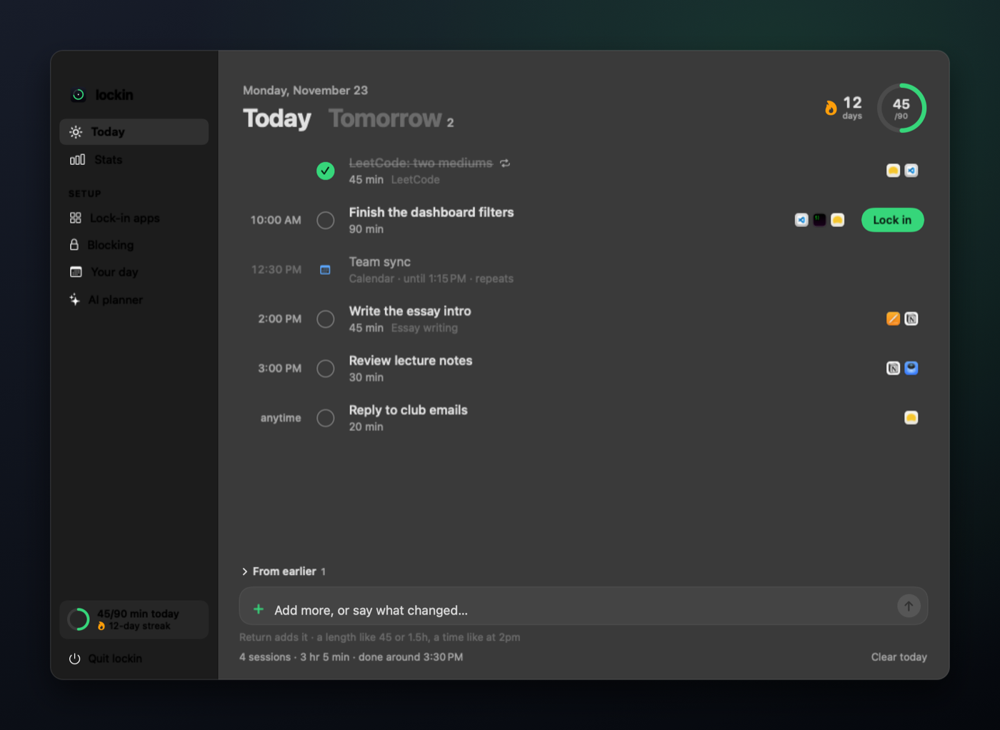
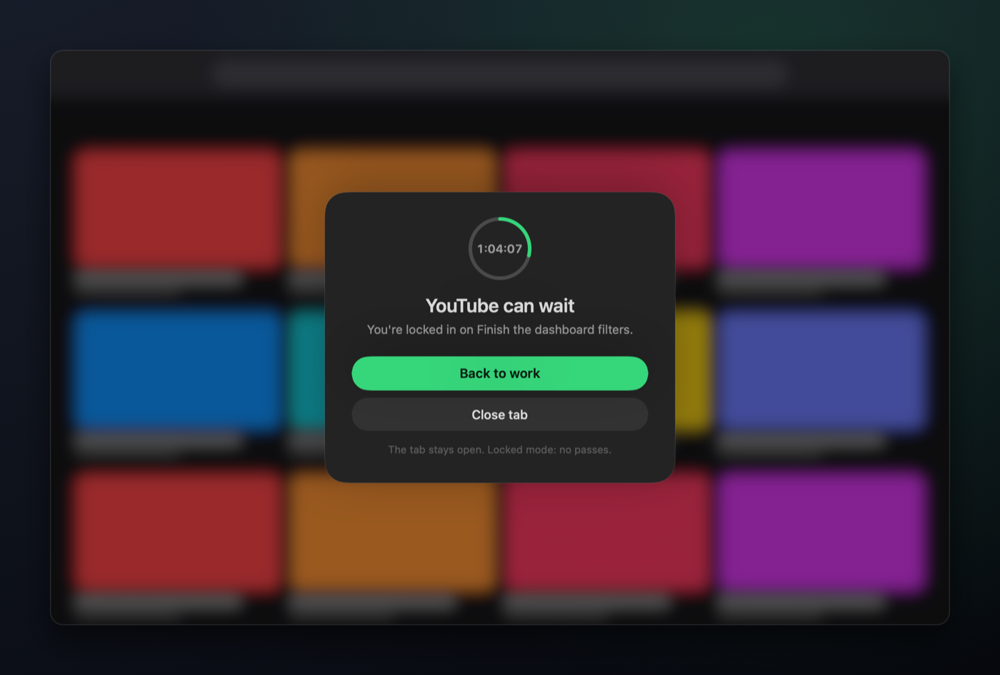
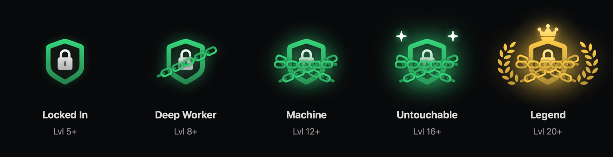
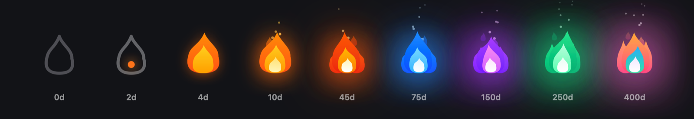
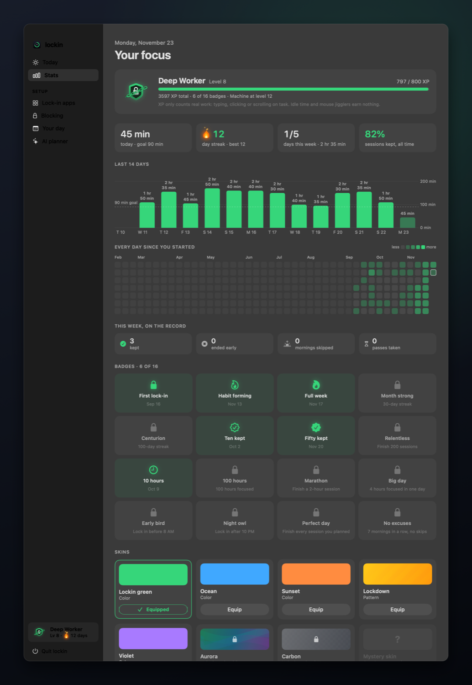

<p align="center"></p>

<h1 align="center">lockin</h1>

<p align="center">
  <b>Plan it. Lock in. Don't break the streak.</b><br>
  Take control of your day before your Mac takes it from you.
</p>

<p align="center">
  <a href="https://github.com/helzeiah/lockin/releases/latest"></a>
  <a href="https://github.com/helzeiah/lockin/actions/workflows/ci.yml"></a>
  
  <a href="LICENSE"></a>
</p>

<p align="center"></p>

## What it does

- **Your day comes first.** The first time you use your Mac each day, your plan covers the screen. Lock in on the
  first session or start your day. Skipping takes a 3-second hold and a reason, and it goes on the record.
- **Plan in one line.** Type `leetcode 45, essay intro 30 at 2pm` and lockin times it around your calendar, then edit
  with `done leetcode` or `free at 8`. No AI needed. An optional AI planner can rework the day for you: Apple
  Intelligence on your Mac (free), your Claude subscription, an API key, or a local model.
- **A block that holds.** A session allows only the few apps it needs, picked from the task's words. Everything else
  gets covered, and in Locked mode it gets hidden. The cover takes the keyboard too, so there's no typing around it.
- **Earn your free time.** YouTube, games and the rest stay covered until today's goal is met. Then they're yours.
- **Accountability you can see.** Streaks, a year of history, and an honest record: sessions kept vs. ended early,
  mornings skipped, passes taken. Planned sessions start on their own, and calendar events ask before they lock you in.
- **Rank up by doing real work.** XP, seven ranks from Rookie to Legend, 16 badges, a streak fire that changes color the
  longer you keep it, and skins you unlock and equip. Only active minutes count, so idling or a mouse jiggler earns nothing.

<p align="center">
  
  &nbsp;
  
</p>
<p align="center"></p>
<p align="center"></p>
<p align="center"></p>

## Install

```bash
curl -fsSL https://raw.githubusercontent.com/helzeiah/lockin/main/install.sh | bash
```

That checks the download against its published SHA-256, puts `lockin.app` in `~/Applications` and opens it. You can
also download `lockin.zip` from the [latest release](https://github.com/helzeiah/lockin/releases/latest). The app
isn't notarized, so the first time, right-click it and choose **Open**.

Requires macOS 14 (Sonoma) or later, on Apple silicon or Intel. A two-minute setup walks you through it: the apps you
work in, what distracts you, how strict to be, permissions, and a daily goal.

## Permissions

| Permission | Why |
|---|---|
| **Automation** (your browser, optionally iTerm) | To see the open tab, so YouTube gets covered and your docs don't. And the folder of a Claude Code session, if a task rule asks for one. |
| **Calendar** (optional) | To show today's events on your plan and offer to lock in when one starts. Read-only. |
| **Login item** (optional) | So the morning screen is there without remembering to open lockin. |

## Privacy

Everything stays on your Mac, in `~/Library/Application Support/lockin`. There are no accounts and no analytics.
The optional AI planner sends only your plan, today's event titles and what you type, to the provider you pick.
API keys live in the macOS Keychain.

## Build from source

Needs the Xcode Command Line Tools (`xcode-select --install`). No Xcode project.

```bash
git clone https://github.com/helzeiah/lockin.git && cd lockin
./app/build.sh             # build, install to ~/Applications, restart it
./app/test.sh              # plan parser, app logic (headless) and helper tests
./app/build.sh --release   # universal build + dist/lockin.zip and its checksum
```

`app/Sources` is the SwiftUI app. `Engine.swift` holds sessions, covers and the daily loop. `Gate.swift` is the
morning screen, `Planner.swift` is Today, `PlanParser.swift` reads the one-line plans, and `Match.swift` picks each
task's apps. `app/Helper` has the Python helper for the AI planner, the recap and free time slots. It runs on the
Python that ships with macOS. Pushing a `v*` tag builds a release.

macOS ties permissions to the app's signature. To keep them across rebuilds, create a free local code-signing
certificate named `lockin Local Signing` (Keychain Access → Certificate Assistant → Create a Certificate…).
`build.sh` uses it automatically.

It's scriptable too: `lockin://start?task=Essay&minutes=25`, `lockin://next`, `lockin://stop`, `lockin://plan`,
and `lockin://tomorrow` work from Shortcuts, Raycast or a terminal.

## License

[MIT](LICENSE)
